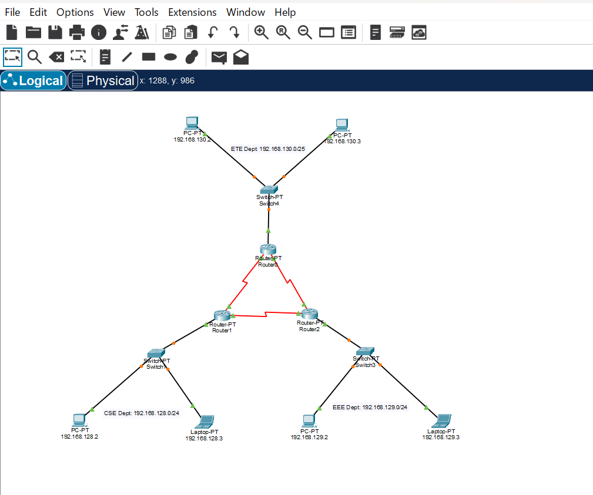

# Subnetting Lab (Cisco Packet Tracer)

## Objective
Practice subnetting a network into smaller subnets and verify connectivity in Packet Tracer.

## Files
- `subnetting-problem-01.pkt`: Packet Tracer lab file

## What I did
- Starting network, e.g. 192.168.128.0/22
- (a) 1st subnet, CSE Department LAN, up to 220 hosts
- (b) 2nd subnet, EEE Department LAN, up to 160 hosts (
- c) 3rd subnet, ETE Department LAN, up to 80 hosts;
- (d) Point to point link between CSE and ETE,
- (e) Point to point link between CSE and EEE
- (f) Point to point to point link between EEE and ETE.

## Verification
- (i) Ping from PC0 to PC5 (ii) PC1 to PC3 and (iii) PC2 to PC5

## What I learned
- I have solved complex subnetting problem

## Topology

